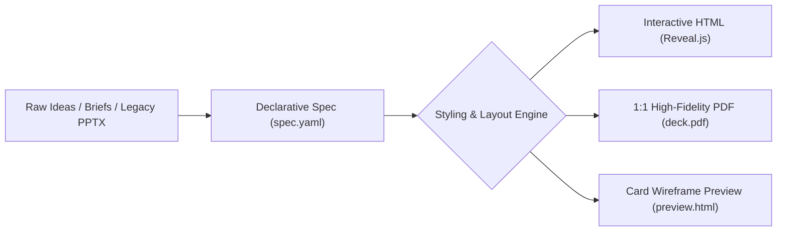
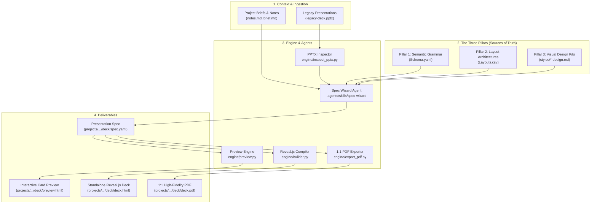
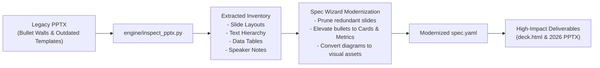
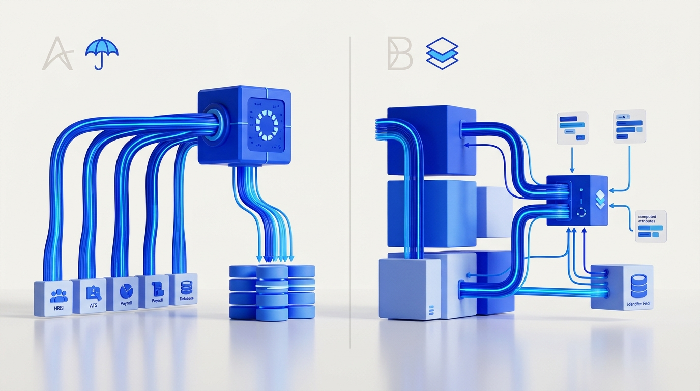

# Slide Deck Builder

<div align="center">


**An autonomous AI presentation engineering pipeline for authoring, modernizing, and compiling high-impact slide decks.**

[](Schema.yaml)
[](Layouts.csv)
[](styles/sailpoint-corporate-2026-design.md)
[](#2-deck-builder-deck-builder)
[](#legacy-powerpoint-modernization)

</div>

---

## Table of Contents

- [Overview & Philosophy](#overview--philosophy)
- [System Architecture (The Three Pillars)](#system-architecture-the-three-pillars)
- [Workspace Hierarchy (`projects/<project-name>/`)](#workspace-hierarchy-projectsproject-name)
- [Autonomous Agent Workflow](#autonomous-agent-workflow)
  - [1. Spec Wizard (`/spec-wizard`)](#1-spec-wizard-spec-wizard)
  - [2. Deck Builder (`/deck-builder`)](#2-deck-builder-deck-builder)
- [Legacy PowerPoint Modernization](#legacy-powerpoint-modernization)
- [Semantic Component Reference](#semantic-component-reference)
  - [Cards](#cards)
  - [Metrics & Telemetry](#metrics--telemetry)
  - [Comparison](#comparison)
  - [Diagrams & Process Flows](#diagrams--process-flows)
  - [Visual Assets & Images](#visual-assets--images)
  - [Multi-Region Columns](#multi-region-columns)
  - [Speaker Notes](#speaker-notes)
- [Layout Architectures Catalog](#layout-architectures-catalog)
- [Design Themes & Visual Kits](#design-themes--visual-kits)
- [Engine CLI Reference](#engine-cli-reference)
- [Presenter Mode & PDF Export](#presenter-mode--pdf-export)
- [Best Practices](#best-practices)

---

## Overview & Philosophy

Slide Deck Builder bridges the gap between structured thought and executive-ready presentations. 

Traditional presentation tools force authors to manually manage pixel layout, typography hierarchy, font sizes, and color palettes while simultaneously trying to craft compelling content. This often leads to inconsistent designs, cluttered slides, and unreadable bullet-point walls.

Slide Deck Builder adopts a **declarative, schema-driven approach**:

1. **Content is Separated from Presentation**: Content is authored in a strict, semantic specification ([`spec.yaml`](Schema.yaml)). The author focuses entirely on ideas, metrics, comparisons, and narrative arc.
2. **Visuals are Driven by Design Systems**: Reusable visual kits ([`styles/`](styles/)) dictate color palettes, typography scales, glassmorphism surfaces, and accent glows. Changing the presentation's look requires modifying only a single theme line.
3. **Dual Compilation Targets**:
   - **Interactive HTML Presentation (`deck.html`)**: Powered by Reveal.js with dark gradient styling, keyboard navigation, overview tile mode, speaker notes window, and zero external runtime dependencies.
   - **1:1 High-Fidelity PDF Export (`deck.pdf`)**: Generates a pixel-perfect standalone PDF presentation matching the browser layout using `engine/export_pdf.py`.



---

## System Architecture (The Three Pillars)

Every presentation in Slide Deck Builder is governed by three foundational pillars:



### Pillar 1: Semantic Schema ([`Schema.yaml`](Schema.yaml))
Defines the strict YAML grammar for deck specifications. Content is structured into semantic components (`cards`, `metrics`, `comparison`, `diagram`, `image`, `bullets`, `notes`) rather than arbitrary text boxes.

### Pillar 2: Slide Architectures ([`Layouts.csv`](Layouts.csv))
Defines the 11 responsive CSS Grid architectures and their corresponding PowerPoint master slide mappings. Specifies grid templates, padding, slot locations, and semantic roles.

### Pillar 3: Visual Design Kits ([`styles/`](styles/))
Markdown-based design systems containing frontmatter color tokens, typography declarations (Google Fonts), spacing definitions, and CSS custom properties.
- **Default Premier Theme**: [`styles/sailpoint-corporate-2026-design.md`](styles/sailpoint-corporate-2026-design.md) — Featuring deep cobalt backgrounds (`#0B111E`), glowing aqua (`#54C0E8`) and magenta (`#D60EB5`) accents, Poppins typography, and dark-mode glassmorphic cards.

---

## Workspace Hierarchy (`projects/<project-name>/`)

All presentations are contained within self-contained project directories under `projects/`:

```
projects/
└── <project-name>/
    ├── brief.md                 # Project brief, goals, background research
    ├── notes.md                 # Source notes, transcripts, or whitepapers
    ├── legacy-deck.pptx         # (Optional) Existing PowerPoint deck to modernize
    └── deck/
        ├── spec.yaml            # Single source of truth adhering to Schema.yaml
        ├── preview.html         # Lightweight responsive card wireframe preview
        ├── deck.html            # Standalone Reveal.js presentation with embedded assets
        ├── deck.pdf             # 1:1 pixel-perfect standalone PDF presentation
        └── assets/              # Generated visuals, diagrams, and illustrations
            ├── cover_concept.jpg
            └── architecture_diagram.png
```

- **Project Root**: Holds raw inputs, reference notes, and legacy materials.
- **`deck/`**: Holds generated presentation artifacts and specifications.
- **`deck/assets/`**: Holds custom visuals referenced by relative paths in `spec.yaml`.

---

## Autonomous Agent Workflow

Presentation authoring follows a structured, human-in-the-loop agent workflow:

```mermaid
flowchart TD
    Start([Start Task]) --> FindProject{Locate Project Directory}
    FindProject -- Not Found --> CreateProj[Interrogate user & create projects/name/deck]
    FindProject -- Exists --> CheckBaseline{Check for legacy .pptx}

    CheckBaseline -- PPTX Found --> AskModernize[Gate: Modernize PPTX or Start Scratch?]
    AskModernize -- Modernize --> RunInspect[Inspect slides & notes: engine/inspect_pptx.py]
    AskModernize -- Scratch --> IngestDocs[Ingest notes.md & brief.md]
    CheckBaseline -- No PPTX --> IngestDocs

    RunInspect --> GrillRound[Discovery & Grilling Round<br/>Title, Goal, Audience, Tone, Modernization Focus]
    IngestDocs --> GrillRound

    GrillRound --> AlignArc[Align on Story Arc & Sections<br/>Allocate slide counts across 3-5 sections]
    AlignArc --> DraftLoop[Tackle Sections Sequentially]

    subgraph SectionDrafting ["Section-by-Section Drafting"]
        DraftLoop --> PickLayout[Assign Layout from Layouts.csv]
        PickLayout --> ComponentMap[Map Semantics: Cards, Metrics, Diagrams]
        ComponentMap --> VisualGate{Custom Visual Needed?}
        VisualGate -- Yes --> AssetConsensus[Gate: Agree on visual prompt & concept]
        AssetConsensus --> GenImage[Generate image to deck/assets/]
        VisualGate -- No --> UpdateSpec[Write to spec.yaml]
        GenImage --> UpdateSpec
        UpdateSpec --> MoreSections{More sections?}
        MoreSections -- Yes --> DraftLoop
    end

    MoreSections -- Done --> GenPreview[Generate preview.html<br/>engine/preview.py]
    GenPreview --> PreviewGate{Preview Approval Gate}

    PreviewGate -- Refine Spec --> DraftLoop
    PreviewGate -- Approved --> BuildDeck[Compile deck.html<br/>engine/builder.py]

    BuildDeck --> ReviewGate{Post-Build Review Gate}
    ReviewGate -- Export PDF --> ExportPDF[Compile deck.pdf<br/>engine/export_pdf.py]
    ReviewGate -- Iterate --> DraftLoop
    ReviewGate -- Finalized --> Completed([Deck Complete & Ready])
```



---

### 1. Spec Wizard (`/spec-wizard`)

The Spec Wizard guides you from raw inputs to a validated presentation specification and visual wireframe:

1. **Workspace Resolution**: Discovers or creates `projects/<project-name>/deck/`.
2. **PowerPoint Baseline Discovery**: If a `.pptx` file is detected, prompts to modernize it as a baseline or start fresh.
3. **The Grilling Round**: Interrogates outcome parameters without making unstated assumptions:
   - Presentation Title & Core Goal
   - Target Audience & Tone
   - Deck Length (`short`: 5–7 slides, `default`: 8–14 slides, `long`: 15+ slides)
   - Visual Theme from [`styles/`](styles/)
   - Modernization Targets (preserved assets, bullet conversions, redundant slide cuts)
4. **Story Arc Alignment**: Agrees on 3 to 5 narrative sections before drafting slide content.
5. **Section-by-Section Drafting**:
   - Assigns layouts from [`Layouts.csv`](Layouts.csv).
   - Maps raw text to semantic components (`cards`, `metrics`, `comparison`, `diagram`).
   - **Visual Asset Consensus**: When custom imagery adds value, proposes visual prompts and obtains approval before running image generation.
6. **Card Wireframe Generation**: Automatically compiles `preview.html` (via `engine/preview.py`) for rapid visual validation.

---

### 2. Deck Builder (`/deck-builder`)

The Deck Builder compiles the approved specification into standalone deliverables:

1. **Spec Validation**: Validates `spec.yaml` against [`Schema.yaml`](Schema.yaml) and layout names against [`Layouts.csv`](Layouts.csv).
2. **Reveal.js Compilation**:
   ```bash
   ./venv/bin/python engine/builder.py projects/<project-name>/deck/spec.yaml projects/<project-name>/deck/deck.html
   ```
   - Automatically inlines local images as Base64 data URIs so that `deck.html` is completely standalone and portable.
3. **Interactive Review Gate**: Presents a structured decision gate:
   - **Export to 1:1 PDF (.pdf)**: Generates pixel-perfect standalone PDF presentation.
   - **Modify / Iterate**: Jump back to adjust copy or layouts.
   - **Keep As-Is / Complete**: Finalize deliverables.
   - **Scrap / Start Over**: Discard and re-draft.
4. **1:1 PDF Export** (when requested):
   ```bash
   ./venv/bin/python engine/export_pdf.py projects/<project-name>/deck/spec.yaml projects/<project-name>/deck/deck.pdf
   ```

---

## Legacy PowerPoint Modernization

Transforming legacy corporate slide decks into modern presentations is a first-class workflow:



### Modernization Steps:
1. Place the legacy file in your project directory: `projects/<project-name>/legacy.pptx`.
2. Inspect the presentation hierarchy:
   ```bash
   ./venv/bin/python engine/inspect_pptx.py projects/<project-name>/legacy.pptx
   ```
3. During the `/spec-wizard` grilling round, define:
   - **Keep**: Critical data points, legal disclaimers, or architecture proofs.
   - **Transform**: Convert dense bullet lists into semantic cards, stat callouts, or before/after comparison grids.
   - **Prune**: Eliminate redundant introductory slides, wall-of-text recaps, and low-value filler.

---

## Semantic Component Reference

`Schema.yaml` provides rich semantic building blocks. Here is how each component is declared in `spec.yaml`:

### Cards

Ideal for feature highlights, principles, pillars, or capability grids. Cards include an icon, badge, title, body narrative, and optional glow highlight.

```yaml
content:
  cards:
    - title: "Unified Identity Fabric"
      body: "Connect multi-cloud directories, HRIS feeds, and SaaS applications into a single authoritative source."
      icon: "cloud"
      badge: "Core Architecture"
      highlight: true
    - title: "Autonomous Correlation"
      body: "Machine learning engines detect and resolve duplicate identities with 99.8% precision."
      icon: "shield"
      badge: "Security AI"
      highlight: false
```

---

### Metrics & Telemetry

Highlight key quantifiable achievements, KPIs, and ROI statistics.

```yaml
content:
  metrics:
    - value: "94%"
      label: "Audit Preparation Speedup"
      subtext: "Reduced from 3 weeks to 1 day"
      highlight: true
    - value: "10x"
      label: "Scale Capacity"
      subtext: "Supports over 50M daily events"
      highlight: false
    - value: "0"
      label: "Orphaned Accounts"
      subtext: "Continuous automated de-provisioning"
      highlight: true
```

---

### Comparison

Side-by-side contrast blocks for "Current State vs. Future State" or "Legacy vs. Next-Gen".

```yaml
content:
  comparison:
    left:
      badge: "Legacy Approach"
      title: "Fragmented Point Solutions"
      bullets:
        - "Manual identity reconciliation across spreadsheets"
        - "Multi-day lag time in offboarding terminated personnel"
        - "Blind spots across cloud workloads and shadow IT"
    right:
      badge: "Identity Fusion NG"
      title: "Unified Autonomous Governance"
      bullets:
        - "Instant policy sync triggered by HR events"
        - "Sub-second zero-trust access revocation"
        - "Continuous identity graph mapping across all SaaS apps"
```

---

### Diagrams & Process Flows

Declare process workflows, pipelines, timelines, and matrices:

```yaml
content:
  diagram:
    kind: "flow" # Options: flow, comparison, matrix, funnel, timeline, hierarchy, cards
    elements:
      - "1. HR Ingestion"
      - "2. Deterministic Match"
      - "3. Probabilistic AI Scorer"
      - "4. Automated Provisioning"
    connections:
      - "1 -> 2"
      - "2 -> 3"
      - "3 -> 4"
    emphasis: "3. Probabilistic AI Scorer"
```

---

### Visual Assets & Images

Embed custom diagrams, illustrations, or architectural flows:



```yaml
layout: "Picture with Caption"
role: "architecture"
title: "Sidecar Pipeline Integration"
subtitle: "Decoupled real-time event ingestion"
content:
  image:
    src: "assets/umbrella_sidecar_architecture.jpg"
    alt: "Sidecar pipeline ingestion architecture"
    caption: "Decoupled sidecar workers process identity correlation asynchronously without impacting primary line-of-business APIs."
  bullets:
    - "Asynchronous event queues isolate downstream spikes"
    - "Zero latency impact on transactional user portals"
    - "Horizontally scalable across multi-region Kubernetes clusters"
```

---

### Multi-Region Columns

Use when a slide has distinct multi-column zones (`Two Content`, `Three Columns`):

```yaml
content:
  regions:
    - id: "col1"
      title: "Discover"
      kind: "text"
      bullets:
        - "Deep scan across 150+ SaaS connectors"
        - "Continuous discovery of shadow accounts"
    - id: "col2"
      title: "Correlate"
      kind: "text"
      bullets:
        - "Machine learning identity graph resolution"
        - "Attribute confidence scoring"
    - id: "col3"
      title: "Govern"
      kind: "text"
      bullets:
        - "Automated certification campaigns"
        - "Policy-driven entitlement revocation"
```

---

### Speaker Notes

Speaker notes are preserved across both HTML presentation view and PowerPoint slides. They are hidden during presentation mode and visible in speaker view (`S` key):

```yaml
notes: |
  Emphasize that the AI correlation engine is deterministic-first.
  Pause on the 94% audit preparation stat—the audit committee found this most compelling.
  Highlight that customer data never leaves their sovereign tenant boundary.
```

---

## Layout Architectures Catalog

[`Layouts.csv`](Layouts.csv) defines 11 responsive slide architectures:

| Layout Name | Standard Role | Grid Architecture | Best Suited Content |
| :--- | :--- | :--- | :--- |
| **`Title Slide`** | Deck cover / Opening | Centered or left vertical flex stack | `title`, `subtitle`, presenter, date, cover visual |
| **`Title and Content`** | Core content / Versatile | Top title bar + large single container | `cards`, `bullets`, `metrics`, or large diagram |
| **`Section Header`** | Transition / Chapter break | Centered full-flood impact statement | Bold transition statement with category badge |
| **`Two Content`** | Side-by-side balanced split | 50/50 equal-width dual column | `regions` (col1, col2), text alongside card stack |
| **`Comparison`** | Before/After contrast | 2 cards with contrast styling | `comparison` (left vs right) |
| **`Three Columns`** | Three pillars / Horizons | 3 equal-width columns | `regions` (col1, col2, col3), 3-step processes |
| **`Four Tiles`** | 2x2 executive matrix | 2x2 card grid | 4 cards, 4 metrics, core capability matrices |
| **`Title Only`** | Custom visual canvas | Top title bar + flexible full-bleed body | Full-width custom diagrams, timeline matrices |
| **`Blank`** | Full visual immersion | Full-screen canvas | Full-bleed hero visuals, demo screenshots |
| **`Content with Caption`** | Asymmetric focus | 1/3 sidebar + 2/3 main card | Featured metric with supporting narrative |
| **`Picture with Caption`** | Annotated visual showcase | 50/50 split (visual left, content right) | Architecture diagrams, UI captures + bullet list |
| **`Agenda`** | Roadmap / Table of contents | Numbered list grid | Executive roadmap, meeting agenda items |

---

## Design Themes & Visual Kits

Design themes live in [`styles/`](styles/) as declarative Markdown files (`*-design.md`). Each style declares color tokens, typography scales, glassmorphic card borders, and dark-mode lighting accents.

### Default Premier Theme: `sailpoint-corporate-2026-design`

The flagship enterprise dark-mode theme tailored for executive technical presentations:

| Token | Hex Value | Role & Usage |
| :--- | :--- | :--- |
| `--color-background` | `#0B111E` | Deep obsidian navy background flood |
| `--color-surface` | `#111827` | Elevated container surfaces |
| `--color-card-bg` | `#151F32` | Glassmorphic card surface with subtle opacity |
| `--color-card-border` | `#2D3E5B` | Frosted border with delicate specular highlights |
| `--color-accent` | `#54C0E8` | Electric aqua for primary accents, badges, and glows |
| `--color-accent-alt` | `#D60EB5` | Vibrant magenta for secondary highlights and deltas |
| `--color-ink` | `#FFFFFF` | Crisp white heading typography |
| `--color-ink-muted` | `#94A3B8` | Cool slate muted body copy |
| `--font-family` | `'Poppins'` | Clean, modern geometric sans-serif |

### Additional Built-In Design Systems:

- `academic-clarity-education-research-design.md`: High-contrast serif & clean sans for educational research.
- `bio-tech-organic-healthcare-pharma-design.md`: Emerald and mint greens with clinical precision.
- `cloud-topology-enterprise-saas-design.md`: Clean enterprise SaaS blues and slate grays.
- `cyber-infrastructure-it-devops-design.md`: Dark terminal aesthetics with neon matrix accents.
- `executive-landscape-boardroom-strategy-design.md`: Refined champagne gold and navy for boardroom strategy.
- `kinetic-keynote-event-vision-design.md`: Ultra-bold keynote typography with high-impact contrast.

To switch themes, change the `theme` field in your `spec.yaml`:
```yaml
theme: "sailpoint-corporate-2026-design"
```

---

## Engine CLI Reference

All engine scripts run via the project Python virtual environment:

```bash
# 1. Inspect an existing PowerPoint presentation (extract inventory, hierarchy, notes):
./venv/bin/python engine/inspect_pptx.py projects/<project-name>/<file>.pptx

# 2. Compile lightweight HTML card wireframe preview:
./venv/bin/python engine/preview.py projects/<project-name>/deck/spec.yaml projects/<project-name>/deck/preview.html

# 3. Compile standalone interactive Reveal.js presentation:
./venv/bin/python engine/builder.py projects/<project-name>/deck/spec.yaml projects/<project-name>/deck/deck.html

# 4. Export to 1:1 high-fidelity PDF (.pdf):
./venv/bin/python engine/export_pdf.py projects/<project-name>/deck/spec.yaml projects/<project-name>/deck/deck.pdf
```

---

## Presenter Mode & PDF Export

The compiled `deck.html` presentation provides presentation capabilities right in the browser:

### Keyboard Navigation Cheatsheet

| Key | Action |
| :--- | :--- |
| **`Space`** or **`→`** / **`↓`** | Advance to next slide |
| **`Shift + Space`** or **`←`** / **`↑`** | Return to previous slide |
| **`Esc`** | **Overview Grid Mode**: Zoom out to see all slides as interactive tiles |
| **`S`** | **Speaker Notes Window**: Opens a secondary display with slide preview, timer, and notes |
| **`F`** | Toggle Fullscreen mode |
| **`B`** or **`.`** | Pause presentation (blank screen) |
| **`Home`** / **`End`** | Jump to first / last slide |

### Speaker Notes Window (`S` key)
Pressing `S` opens an independent presenter console showing:
- Current slide view
- Upcoming slide preview
- Live elapsed presentation timer and clock
- Formatted speaker script and cues from your `notes` field

### Exporting to PDF
To create a presentation PDF:
1. Open `deck.html` in Chrome, Brave, or Edge.
2. Append `?print-pdf` to the URL:
   ```
   file:///path/to/projects/<project-name>/deck/deck.html?print-pdf
   ```
3. Open the browser Print dialog (`Cmd + P` on Mac, `Ctrl + P` on Windows).
4. Set **Destination** to `Save as PDF`.
5. Set **Layout** to `Landscape`.
6. Set **Margins** to `None`.
7. Enable **Background graphics**.
8. Click **Save**.

---

## Best Practices

1. **Keep Slides Focused**: Aim for one primary idea per slide. If a slide requires multiple paragraphs of body text, convert them into `cards` or split into two slides.
2. **Lead with Metrics**: Place quantifiable proof points (`metrics`) immediately following problem statements or architecture reveals.
3. **Use Eyebrow Badges**: Use the `badge` field to provide instant organizational context (e.g. `'Milestone 2'`, `'Zero Trust'`, `'Q3 2026'`).
4. **Leverage Speaker Notes**: Move detailed technical deep-dives and vocal cues into `notes:` so the visual slide remains uncluttered.
5. **Always Review Preview First**: Use `preview.html` to validate narrative flow and layout variety before generating high-res visual assets and compiling `deck.html`.
